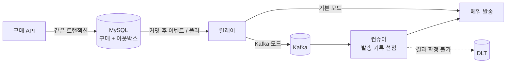

# Todo — 포인트로 서로의 할 일을 사고파는 개인 프로젝트

Spring Boot(Kotlin) 기반 백엔드 프로젝트입니다. 할 일 관리에 "포인트로 서로의 할 일을 사고판다"는 거래 기능을 얹고, 여러 사용자가 동시에 같은 자원을 건드리거나 서버가 죽을 때 생기는 문제를 직접 재현하고 고쳐 보는 것을 목표로 만들었습니다.

1인 프로젝트이며, 안드로이드 개발자로 일하며 백엔드로 방향을 바꾸기 위해 시작했습니다.

---

## 1. 주요 기능

- 할 일 생성, 수정, 삭제, 완료 체크, 카테고리(여러 개 가능)
- 로그인한 사용자의 할 일 목록 조회와 관리 (JWT)
- 포인트 충전, 다른 사용자의 할 일 구매 요청 → 판매자 승인/거절 → 구매자 취소
- 구매 요청, 승인, 거절 시 이메일 알림
- 자주 조회되는 데이터는 Redis 캐시

## 2. 구조



## 3. 주요 작업

### 포인트 거래 동시성: 데드락 진단부터 불필요한 락 제거까지

- 같은 사용자에게 충전과 판매가 동시에 일어나면 잔액이 사라지는 lost update를 테스트로 재현하고, 분산락(Redisson)과 재시도로 1차 해결했습니다.
- 교차 거래 부하 테스트(k6) 중 MySQL 데드락 예외를 발견하고, `SHOW ENGINE INNODB STATUS`로 거래 방향에 따라 두 계정의 락 순서가 뒤바뀌는 것을 확인해 계정 ID 정렬로 접근 순서를 고정했습니다.
- 이후 실행 계획, 락 유지 시간, 커넥션 풀을 차례로 확인해 원인을 좁히고, 비관적 락을 조건부 UPDATE 한 번의 원자적 업데이트로 바꿨습니다.
- 결과: 응답시간 중앙값 3~4배, p99 최대 2배 개선. 재측정 시 VU 62 기준 446 req/s, 실패율 0% (로컬 단일 머신 기준)

관련 PR: [#92 분산락 재시도, 낙관적 락](https://github.com/Ahn-seokjoo/todo-spring/pull/92) · [#96 데드락 해결](https://github.com/Ahn-seokjoo/todo-spring/pull/96) · [#98 원자적 UPDATE로 충전 지연 해소](https://github.com/Ahn-seokjoo/todo-spring/pull/98)

### 구매 알림 안정화: 아웃박스로 서버가 죽어도 알림 이벤트를 잃지 않는 구조

- 구매와 같은 트랜잭션에 아웃박스 이벤트를 저장하고, 커밋 후 비동기로 발송합니다. 메일 서버 응답을 3초 지연시켜도 구매 API는 30ms대로 응답했습니다.
- 서버 3대 중 1대를 처리 도중 종료했을 때 멈춰 버린 이벤트를 폴러가 되돌려 재처리하고, 5회 실패하면 DLQ로 옮깁니다.
- 여러 서버가 같은 이벤트를 동시에 처리하지 않도록 조건부 UPDATE로 선점하고, 선점 시각을 펜싱 토큰으로 써서 늦게 끝난 서버가 결과를 덮어쓰지 못하게 했습니다.

관련 PR: [#103 구매 승인 방식 전환](https://github.com/Ahn-seokjoo/todo-spring/pull/103) · [#104 아웃박스 + 이메일 발송](https://github.com/Ahn-seokjoo/todo-spring/pull/104) · [#106 폴러, DLQ, 펜싱 토큰](https://github.com/Ahn-seokjoo/todo-spring/pull/106)

### Kafka 전달 경로 (로컬 검증)

- 알림 전달 구간에 Kafka를 거치는 경로(릴레이 → Kafka → 컨슈머)를 추가했습니다. `outbox.delivery-mode` 설정으로 전환하며, 기본값은 기존 방식입니다.
- 컨슈머는 아웃박스 id로 발송 기록을 먼저 선점해 같은 이벤트가 여러 번 와도 메일을 한 번만 보냅니다. 발송 결과를 확정할 수 없는 이벤트는 다시 보내지 않고 DLT로 분리합니다.
- 토픽을 처음부터 다시 읽게 해도 추가 발송이 없는 것, 브로커가 멈춘 동안 들어온 요청이 복구 후 전달되는 것을 로컬에서 확인했습니다.

관련 PR: [#111 Kafka 전달 경로](https://github.com/Ahn-seokjoo/todo-spring/pull/111)

## 4. 기술 스택

| 분류 | 사용 기술 |
| --- | --- |
| 언어 / 프레임워크 | Kotlin, Spring Boot |
| 데이터 | MySQL, JPA/Hibernate, Flyway, Redis(Redisson) |
| 메시징 | Kafka |
| 인증 | JWT |
| 테스트 / 부하 테스트 | JUnit5, Kotest, MockK, k6 |
| 배포 | Docker, Docker Compose |

## 5. 알려진 한계

- 자동 테스트는 H2 인메모리 DB로 돌아갑니다. H2는 MySQL(InnoDB)과 잠금 동작이 달라, 데드락과 원자적 UPDATE의 실제 동작은 로컬 MySQL 부하 테스트(k6)로 확인했습니다. MySQL 기반 테스트로 옮기는 것이 다음 과제입니다.
- 운영 Kafka는 단일 브로커(복제 1)라 브로커 장애에 대한 이중화는 없습니다. 메일 테스트용 서버(Mailpit)는 로컬 전용입니다.
- DLT로 분리된 이벤트를 운영자가 확인하고 처리하는 절차는 아직 없습니다.
- 캐시는 변경이 생기면 사용자 구분 없이 전체를 비우고 있어, 사용자 단위 무효화로 바꿀 예정입니다.
- 운영 배포는 단일 서버 Docker Compose입니다. Docker Swarm은 다중 인스턴스 실험(아웃박스 크래시 복구)에만 사용했으며, 오토스케일링이나 고가용성을 검증한 것은 아닙니다.

## 6. 실행 방법

실행 시 `.env` 파일이 필요합니다. 필요한 키는 `.env.example`을 참고합니다.

### 로컬 개발

| 명령어 | 설명 |
| --- | --- |
| `make local-up` | 로컬 컨테이너 실행 (MySQL, Redis, Kafka, Mailpit) |
| `make local-down` | 로컬 컨테이너 중지 및 삭제 |
| `make restart-local` | 로컬 컨테이너 재시작 |

Kafka 모드로 실행하려면 `kafka` 프로필을 켭니다. 메일은 Mailpit(http://localhost:8025)에서 확인할 수 있습니다.

```bash
./gradlew bootRun --args='--spring.profiles.active=kafka,mailpit'
```

### 프로덕션 배포

이미지는 develop에 PR이 머지되면 GitHub Actions가 빌드해 `latest`와 머지 커밋 sha(40자 전체) 태그로 Docker Hub에 올립니다. 서버는 `.env`의 `IMAGE_TAG`에 적힌 sha 이미지만 실행합니다.

| 명령어 | 설명 |
| --- | --- |
| `make prod-up` | `.env`의 `IMAGE_TAG` 이미지를 pull 후 프로덕션 컨테이너 실행 |
| `make prod-down` | 프로덕션 컨테이너 종료 및 삭제 |
| `make restart-prod` | 프로덕션 컨테이너 재시작 |

배포와 롤백은 같은 절차입니다.

```bash
# 서버 ~/todo 에서
vi .env            # IMAGE_TAG=<배포할 커밋 sha 40자>  (롤백이면 이전 sha)
make prod-up      # IMAGE_TAG가 비어 있으면 실행되지 않음
docker compose -f docker-compose.yml -f docker-compose.prod.yml ps   # IMAGE 칸에서 sha 확인
```

롤백은 이미지만 되돌립니다. 이미 적용된 Flyway 마이그레이션은 되돌아가지 않으므로, 컬럼 삭제·이름 변경은 추가 → 배포 → 삭제 순서로 나눠 진행합니다.

### 다중 인스턴스 실험용 (Docker Swarm)

아웃박스 크래시 복구 실험(서버 3대 중 1대 종료)에 사용했습니다. 운영 배포에는 사용하지 않습니다.

| 명령어 | 설명 |
| --- | --- |
| `make stack-up` | Docker Swarm 초기화 후 스택 배포 (`todo-stack`) |
| `make stack-down` | Docker Swarm 모드 종료 |
| `make stack-ps` | 스택 내 서비스 상태 확인 |
