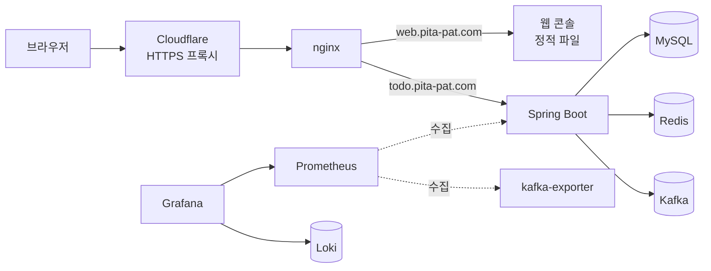
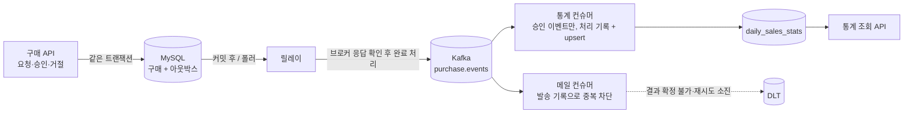

# Todo — 포인트로 서로의 할 일을 사고파는 개인 프로젝트

Spring Boot(Kotlin) 기반 백엔드 프로젝트입니다. 할 일 관리에 "포인트로 서로의 할 일을 사고판다"는 거래 기능을 얹고, 그 위에서 **데이터를 빠르게 서빙하는 법**(인덱스, 선계산, 캐시)과 **데이터가 유실되거나 중복되지 않게 전달하는 법**(아웃박스, Kafka, 멱등 집계)을 직접 측정하며 만들어 보는 것을 목표로 했습니다.

1인 프로젝트이며, 안드로이드 개발자로 일하며 백엔드로 방향을 바꾸기 위해 시작했습니다.

- 웹 콘솔 (테스트용): https://web.pita-pat.com
- API: https://todo.pita-pat.com

## 한눈에 보기

| 작업 | As-is → To-be | 근거 |
| --- | --- | --- |
| 판매 통계 쿼리 인덱스 튜닝 | 300만 건 풀스캔 1,118ms → 커버링 인덱스 0.19ms (읽은 행 300만 → 20) | [#112](https://github.com/Ahn-seokjoo/todo-spring/pull/112) |
| 판매 통계 선계산 테이블 | 헤비 판매자 30일 조회 p95 46.4ms → 9.3ms, 처리량 272 → 1,551 req/s | [#127](https://github.com/Ahn-seokjoo/todo-spring/pull/127) |
| 목록 캐시 무효화 범위 축소 | 캐시 적중률 75.4% → 99.6%, 목록 p99 217ms → 42ms | [#131](https://github.com/Ahn-seokjoo/todo-spring/pull/131) |
| 포인트 거래 동시성 | 데드락 제거, 비관적 락 → 조건부 UPDATE, 응답시간 중앙값 3~4배 개선 | [#96](https://github.com/Ahn-seokjoo/todo-spring/pull/96) · [#98](https://github.com/Ahn-seokjoo/todo-spring/pull/98) |

모든 수치는 로컬 단일 머신(앱, MySQL, k6를 맥 한 대에서 실행)에서 측정했습니다. 절대값보다 같은 조건에서 비교한 상대 차이를 근거로 봐 주세요.

---

## 1. 주요 기능

- 할 일 생성, 수정, 삭제, 완료 체크, 카테고리(여러 개 가능)
- 로그인한 사용자의 할 일 목록 조회와 관리 (JWT)
- 마켓: 모든 사용자의 할 일을 최신순으로 "더 보기" (keyset 페이지네이션)
- 포인트 충전, 다른 사용자의 할 일 구매 요청 → 판매자 승인/거절 → 구매자 취소
- 구매 요청, 승인, 거절 시 이메일 알림
- 판매자 일별 매출 조회 (원본 집계 API, 선계산 통계 API)
- 테스트용 웹 콘솔: 회원가입, 충전, 할 일 등록·수정, 마켓, 구매 요청과 승인, 매출 조회를 브라우저에서 실행

## 2. 구조

### 운영 구성



### 데이터 흐름: 수집 → 처리 → 저장 → 서빙



## 3. 주요 작업

### 판매 통계 서빙: 인덱스 튜닝에서 선계산 테이블까지

판매자의 30일 일별 매출 조회를 대상으로, 원본 테이블 튜닝과 선계산 테이블을 차례로 적용하고 같은 조건에서 비교했습니다.

**① 원본 집계 쿼리 튜닝 (#112)**
- 구매 300만 건에서 인덱스 없이 1,118ms(풀스캔). `EXPLAIN ANALYZE`로 단계별 비용을 확인하며 복합 인덱스 → 커버링 인덱스 `(seller_id, purchase_status, created_at, price)`로 바꿨습니다.
- 결과: 0.19ms, 읽은 행 300만 → 20. API 기준 응답 중앙값 1.41s → 5.25ms, 처리량 약 7 → 1,790 req/s
- 컬럼 순서는 등치 조건 먼저, 범위 조건(`created_at`) 마지막으로 두었습니다. 범위 컬럼이 앞에 오면 30일치 전체 판매자를 훑게 됩니다.

**② 선계산 테이블 (#125, #127)**
- 승인 이벤트를 Kafka 컨슈머가 받아 `daily_sales_stats`(판매자, 날짜별 합계)에 upsert하고, 조회 API는 이 테이블을 읽습니다.
- **일반 판매자(하루 약 1건)는 두 방식의 차이가 없었습니다.** DB 차이(0.37ms vs 0.12ms)가 요청당 약 5.5ms인 앱·네트워크 비용에 묻혔습니다.
- **헤비 판매자(하루 1,000건 × 30일)에서만 차이가 났습니다.** 원본은 3만 행을 읽어 p95 46.4ms, 통계는 30행을 읽어 9.3ms. 처리량은 272 → 1,551 req/s
- 원본 비용은 "판매자 1명의 기간 내 판매 건수"에, 통계 비용은 "기간 일수"에만 비례한다는 것을 측정으로 확인했습니다.
- PK 컬럼 순서 실험: `(sales_date, seller_id)`면 같은 조회가 109,697행을 읽고(66~73ms), `(seller_id, sales_date)`면 14행만 읽습니다(0.12ms). 첫 컬럼에 범위 조건이 걸리면 두 번째 컬럼으로 범위를 좁히지 못하기 때문입니다.
- 트레이드오프: 더하는 일을 조회 시점에서 쓰기 시점으로 옮겼습니다. 승인 직후 잠깐 통계에 늦게 반영되고(최종 일관성), 원본은 요청일, 통계는 승인일 기준이라 날짜 기준이 다릅니다. 두 API를 함께 두어 결과를 비교·검증할 수 있게 했습니다.

**③ 목록 API의 페이지네이션 (#132)**
- 마켓 목록은 keyset(`id < cursor`) 방식의 "더 보기"로 구현해 깊은 페이지도 비용이 같습니다.
- 할 일과 카테고리는 1:N이라 컬렉션 fetch join과 LIMIT을 함께 쓰면 하이버네이트가 전체를 메모리에서 페이징합니다. 할 일 id를 먼저 LIMIT으로 자르고, 그 할 일에만 카테고리를 붙이는 쿼리 2개로 나눴습니다.

관련 PR: [#112 인덱스 튜닝](https://github.com/Ahn-seokjoo/todo-spring/pull/112) · [#125 매출 통계 컨슈머](https://github.com/Ahn-seokjoo/todo-spring/pull/125) · [#127 선계산 통계 조회 API](https://github.com/Ahn-seokjoo/todo-spring/pull/127) · [#132 마켓 목록](https://github.com/Ahn-seokjoo/todo-spring/pull/132)

### 캐시: 무효화 범위를 사용자 단위로 줄이기

- 할 일 하나를 수정할 때마다 목록 캐시 전체를 비우고 있었습니다. 사용자 50명이 목록을 보고 1명이 초당 2번 수정하는 부하 테스트에서 적중률이 75.4%였고, **미스 3,008건 ≈ 수정 60회 × 사용자 50명**으로 원인이 전체 삭제임을 수치로 맞췄습니다.
- 수정한 사용자의 목록 캐시만 지우도록 바꿨습니다. Redis를 막는 `KEYS` 대신 커서 기반 `SCAN`으로 키를 찾고, 100개씩 `UNLINK`로 지웁니다.
- 결과: 적중률 75.4% → 99.6%, 목록 p99 217ms → 42ms, 수정 p99 562ms → 99ms
- 캐시 무효화는 트랜잭션 커밋 후(`AFTER_COMMIT`)에 실행해, 커밋 전 옛 값이 다시 캐시에 들어가는 것을 막습니다. 롤백되면 무효화도 실행되지 않습니다.
- 아이디에 들어간 `*`, `?` 같은 글롭 문자가 다른 사용자 키와 섞이지 않게 패턴을 이스케이프하고, 지우기 전에 키 형식을 정규식으로 한 번 더 확인합니다. 이후 회원가입 아이디 규칙(#135)으로 입력 단계에서도 막았고, 리스너 쪽 방어는 그대로 둡니다.

관련 PR: [#131 사용자별 캐시 무효화](https://github.com/Ahn-seokjoo/todo-spring/pull/131) · [#135 입력 검증](https://github.com/Ahn-seokjoo/todo-spring/pull/135)

### 데이터 정확성: 유실 없이 전달하고, 중복은 결과에 반영하지 않기

- 구매와 같은 트랜잭션에 아웃박스 이벤트를 저장하고 커밋 후 비동기로 전달합니다. 메일 서버 응답을 3초 지연시켜도 구매 API는 30ms대로 응답했습니다.
- 서버 3대 중 1대를 처리 도중 종료해도 폴러가 멈춘 이벤트를 회수해 재처리하고, 5회 실패하면 DLQ로 옮깁니다. 선점은 조건부 UPDATE로 하고, 선점 시각을 펜싱 토큰으로 써서 늦게 끝난 서버가 다른 서버의 결과를 덮어쓰지 못하게 했습니다.
- 릴레이는 Kafka 브로커의 저장 응답을 받은 뒤에만 아웃박스를 완료 처리합니다. 유실은 막는 대신 같은 이벤트가 두 번 발행될 수 있어(at-least-once), 컨슈머를 멱등하게 만들었습니다.
  - 메일: 아웃박스 id로 발송 기록을 먼저 선점해 한 번만 보냅니다. 발송 결과를 확정할 수 없는 이벤트는 다시 보내지 않고 DLT로 분리합니다.
  - 통계: 처리한 이벤트 id를 합산과 같은 트랜잭션에 기록해 중복 합산을 막습니다.
- 토픽을 처음부터 다시 읽게 해도 메일이 추가로 나가지 않는 것, 브로커가 멈춘 동안 들어온 요청이 복구 후 전달되는 것을 로컬에서 확인했습니다. 통계도 같은 방식(처리 기록)으로 다시 읽을 때 중복 합산을 막습니다.
- Kafka는 같은 구매 이벤트를 메일과 통계 두 곳에서 쓰기 위해 넣었습니다. `outbox.delivery-mode` 설정으로 Kafka 없이 직접 발송하는 방식으로도 바꿀 수 있습니다.

관련 PR: [#104 아웃박스 + 이메일 발송](https://github.com/Ahn-seokjoo/todo-spring/pull/104) · [#106 폴러, DLQ, 펜싱 토큰](https://github.com/Ahn-seokjoo/todo-spring/pull/106) · [#111 Kafka 전달 경로](https://github.com/Ahn-seokjoo/todo-spring/pull/111) · [#125 매출 통계 컨슈머](https://github.com/Ahn-seokjoo/todo-spring/pull/125)

### 포인트 거래 동시성: 데드락 진단부터 불필요한 락 제거까지

- 같은 사용자에게 충전과 판매가 동시에 일어나면 잔액이 사라지는 lost update를 테스트로 재현하고, 분산락(Redisson)과 재시도로 1차 해결했습니다.
- 교차 거래 부하 테스트(k6) 중 데드락을 발견하고, `SHOW ENGINE INNODB STATUS`로 거래 방향에 따라 두 계정의 락 순서가 뒤바뀌는 것을 확인해 계정 ID 정렬로 접근 순서를 고정했습니다.
- 이후 실행 계획, 락 유지 시간, 커넥션 풀을 차례로 확인해 원인을 좁히고, 비관적 락을 조건부 UPDATE 한 번의 원자적 업데이트로 바꿨습니다.
- 결과: 응답시간 중앙값 3~4배, p99 최대 2배 개선. VU 62 기준 446 req/s, 실패율 0%

관련 PR: [#92 분산락 재시도, 낙관적 락](https://github.com/Ahn-seokjoo/todo-spring/pull/92) · [#96 데드락 해결](https://github.com/Ahn-seokjoo/todo-spring/pull/96) · [#98 원자적 UPDATE](https://github.com/Ahn-seokjoo/todo-spring/pull/98)

### 운영: 배포와 관측

- Oracle Cloud 단일 서버에 Docker Compose로 배포합니다. 이미지는 머지 커밋 sha로 태깅해 배포와 롤백을 `.env`의 태그 변경 한 번으로 처리합니다.
- Cloudflare 프록시 뒤에 두고 원본 인증서로 구간 전체를 HTTPS로 연결했고, nginx에서 Cloudflare IP 대역이 아닌 연결은 끊습니다.
- Prometheus, Grafana로 컨슈머 lag, 발행 속도, DLT 누적을 보고(컨슈머가 죽어도 보이도록 브로커 기준 지표), Loki로 로그를 모읍니다.
- 웹(`web.`)과 API(`todo.`)를 다른 출처로 분리하며, 토큰 없는 preflight가 JWT 필터에서 막히는 문제를 CORS 처리를 인증 필터 앞으로 옮겨 해결했습니다.

관련 PR: [#114 운영 배포](https://github.com/Ahn-seokjoo/todo-spring/pull/114) · [#115 HTTPS, 원본 보호](https://github.com/Ahn-seokjoo/todo-spring/pull/115) · [#116 lag, DLT 모니터링](https://github.com/Ahn-seokjoo/todo-spring/pull/116) · [#118 CORS](https://github.com/Ahn-seokjoo/todo-spring/pull/118) · [#124 로그 수집](https://github.com/Ahn-seokjoo/todo-spring/pull/124)

## 4. 기술 스택

| 분류 | 사용 기술 |
| --- | --- |
| 언어 / 프레임워크 | Kotlin, Spring Boot |
| 데이터 | MySQL, JPA/Hibernate, Flyway, Redis(Redisson) |
| 메시징 | Kafka |
| 인증 | JWT |
| 테스트 / 부하 테스트 | JUnit5, Kotest, MockK, k6 |
| 배포 / 인프라 | Docker, Docker Compose, Oracle Cloud, Cloudflare, nginx, GitHub Actions |
| 관측 | Prometheus, Grafana, Loki, Alloy |

## 5. 설계 선택과 한계

- **측정 환경:** 모든 수치는 로컬 단일 머신 기준입니다. 실제 서비스 규모의 트래픽이나 데이터로 검증한 것은 아닙니다.
- **테스트 DB:** 자동 테스트 일부는 H2로 돌아갑니다. H2는 InnoDB와 잠금 동작이 달라, 데드락과 원자적 UPDATE는 로컬 MySQL 부하 테스트로 확인했습니다.
- **Kafka:** 운영은 비용 때문에 단일 브로커(복제 1)입니다. 브로커가 멈추면 전달이 멈추지만 아웃박스에 남은 이벤트는 복구 후 이어서 전달됩니다. 다만 이미 발행되어 아웃박스에서 아카이브로 옮겨진 이벤트는 브로커 디스크가 유실되면 복구할 곳이 없어, 운영 규모라면 브로커 3대와 `min.insync.replicas=2`가 필요합니다.
- **배포:** 단일 서버라 배포 중 앱이 다시 뜨는 동안(약 20초) 요청이 실패합니다. Docker Swarm은 다중 인스턴스 실험(아웃박스 크래시 복구)에만 사용했습니다.
- **다음 과제**
  - 캐시 장애 시 DB로 대체(`CacheErrorHandler`). 분산락은 대체할 수 없어 실패시키는 것이 맞다고 봅니다.
  - 프로듀서 재시도 시간(`delivery.timeout.ms`)과 릴레이의 응답 대기 시간을 맞춰 불필요한 재발행 줄이기
  - `stats_processed_event` 보관 기간 정리 배치, 컨슈머가 여러 개일 때 같은 행 동시 upsert 경합 확인

## 6. 실행 방법

실행 시 `.env` 파일이 필요합니다. 필요한 키는 `.env.example`을 참고합니다.

```bash
# 로컬: 인프라 컨테이너 실행 후 앱 실행 (Kafka 모드)
make local-up
./gradlew bootRun --args='--spring.profiles.active=kafka,mailpit'
```

웹 콘솔 http://localhost:8088 · Grafana http://localhost:3000 · Mailpit http://localhost:8025

운영 배포와 롤백은 같은 절차입니다. PR이 머지되면 GitHub Actions가 머지 커밋 sha 태그로 이미지를 올리고, 서버에서는 `.env`의 `IMAGE_TAG`만 바꿔 실행합니다.

```bash
vi .env        # IMAGE_TAG=<배포할 커밋 sha>  (롤백이면 이전 sha)
make prod-up
```

