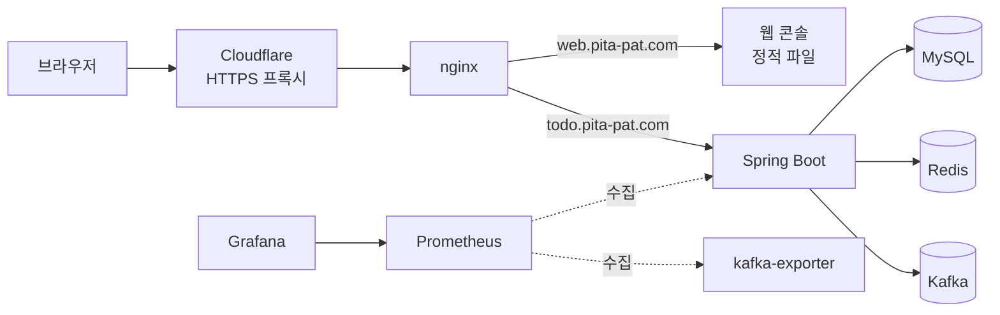
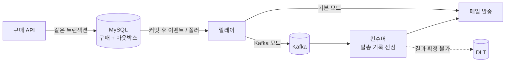

# Todo — 포인트로 서로의 할 일을 사고파는 개인 프로젝트

Spring Boot(Kotlin) 기반 백엔드 프로젝트입니다. 할 일 관리에 "포인트로 서로의 할 일을 사고판다"는 거래 기능을 얹고, 여러 사용자가 동시에 같은 자원을 건드리거나 서버가 죽을 때 생기는 문제를 직접 재현하고 고쳐 보는 것을 목표로 만들었습니다.

1인 프로젝트이며, 안드로이드 개발자로 일하며 백엔드로 방향을 바꾸기 위해 시작했습니다.

- 웹 콘솔 (테스트용): https://web.pita-pat.com
- API: https://todo.pita-pat.com

---

## 1. 주요 기능

- 할 일 생성, 수정, 삭제, 완료 체크, 카테고리(여러 개 가능)
- 로그인한 사용자의 할 일 목록 조회와 관리 (JWT)
- 포인트 충전, 다른 사용자의 할 일 구매 요청 → 판매자 승인/거절 → 구매자 취소
- 구매 요청, 승인, 거절 시 이메일 알림
- 자주 조회되는 데이터는 Redis 캐시
- 테스트용 웹 콘솔: 회원가입, 충전, 투두 등록, 구매 요청과 승인, 일일 매출을 브라우저에서 실행

## 2. 구조

### 운영 구성



### 구매 알림 흐름



## 3. 주요 작업

### 포인트 거래 동시성: 데드락 진단부터 불필요한 락 제거까지

- 같은 사용자에게 충전과 판매가 동시에 일어나면 잔액이 사라지는 lost update를 테스트로 재현하고, 분산락(Redisson)과 재시도로 1차 해결했습니다.
- 교차 거래 부하 테스트(k6) 중 MySQL 데드락 예외를 발견하고, `SHOW ENGINE INNODB STATUS`로 거래 방향에 따라 두 계정의 락 순서가 뒤바뀌는 것을 확인해 계정 ID 정렬로 접근 순서를 고정했습니다.
- 이후 실행 계획, 락 유지 시간, 커넥션 풀을 차례로 확인해 원인을 좁히고, 비관적 락을 조건부 UPDATE 한 번의 원자적 업데이트로 바꿨습니다.
- 결과: 응답시간 중앙값 3~4배, p99 최대 2배 개선. 재측정 시 VU 62 기준 446 req/s, 실패율 0% (로컬 단일 머신 기준)

관련 PR: [#92 분산락 재시도, 낙관적 락](https://github.com/Ahn-seokjoo/todo-spring/pull/92) · [#96 데드락 해결](https://github.com/Ahn-seokjoo/todo-spring/pull/96) · [#98 원자적 UPDATE로 충전 지연 해소](https://github.com/Ahn-seokjoo/todo-spring/pull/98)

### 구매 알림 안정화: 아웃박스로 서버가 죽어도 알림 이벤트를 잃지 않는 구조

- 구매와 같은 트랜잭션에 아웃박스 이벤트를 저장하고, 커밋 후 비동기로 발송합니다. 메일 서버 응답을 3초 지연시켜도 구매 API는 30ms대로 응답했습니다.
- 서버 3대 중 1대를 처리 도중 종료했을 때 멈춰 버린 이벤트를 폴러가 되돌려 재처리하고, 5회 실패하면 DLQ로 옮깁니다.
- 여러 서버가 같은 이벤트를 동시에 처리하지 않도록 조건부 UPDATE로 선점하고, 선점 시각을 펜싱 토큰으로 써서 늦게 끝난 서버가 결과를 덮어쓰지 못하게 했습니다.

관련 PR: [#103 구매 승인 방식 전환](https://github.com/Ahn-seokjoo/todo-spring/pull/103) · [#104 아웃박스 + 이메일 발송](https://github.com/Ahn-seokjoo/todo-spring/pull/104) · [#106 폴러, DLQ, 펜싱 토큰](https://github.com/Ahn-seokjoo/todo-spring/pull/106)

### Kafka 전달 경로

- 알림 전달 구간에 Kafka를 거치는 경로(릴레이 → Kafka → 컨슈머)를 추가했습니다. `outbox.delivery-mode` 설정으로 전환하며, 기본값은 기존 방식입니다.
- 컨슈머는 아웃박스 id로 발송 기록을 먼저 선점해 같은 이벤트가 여러 번 와도 메일을 한 번만 보냅니다. 발송 결과를 확정할 수 없는 이벤트는 다시 보내지 않고 DLT로 분리합니다.
- 토픽을 처음부터 다시 읽게 해도 추가 발송이 없는 것, 브로커가 멈춘 동안 들어온 요청이 복구 후 전달되는 것을 로컬에서 확인했습니다.

관련 PR: [#111 Kafka 전달 경로](https://github.com/Ahn-seokjoo/todo-spring/pull/111)

### 운영 배포와 관측

- Oracle Cloud 단일 서버에 Docker Compose로 배포했습니다. 이미지는 머지 커밋 sha로 태깅해, 배포와 롤백을 `.env`의 태그 변경 한 번으로 처리합니다.
- Cloudflare 프록시 뒤에 두고 원본 인증서로 구간 전체를 HTTPS로 연결했으며, nginx에서 Cloudflare IP 대역이 아닌 연결은 끊어 서버 IP로 직접 들어오는 요청을 막았습니다.
- Prometheus와 Grafana로 컨슈머 lag, 토픽 발행 속도, DLT 누적 건수를 대시보드로 확인합니다. 컨슈머가 죽어도 lag을 볼 수 있도록 브로커 기준(kafka-exporter) 지표를 사용합니다.

관련 PR: [#114 운영 배포 준비](https://github.com/Ahn-seokjoo/todo-spring/pull/114) · [#115 HTTPS, 원본 보호](https://github.com/Ahn-seokjoo/todo-spring/pull/115) · [#116 lag, DLT 모니터링](https://github.com/Ahn-seokjoo/todo-spring/pull/116)

### 웹 콘솔과 CORS

- 웹(`web.pita-pat.com`)과 API(`todo.pita-pat.com`)를 다른 출처로 분리해 CORS를 적용했습니다.
- MVC 레벨 CORS 설정에서는 토큰이 없는 preflight가 JWT 필터에서 먼저 막히고, 필터가 만든 401 응답에도 CORS 헤더가 없어 브라우저가 응답을 버리는 문제를 확인했습니다. CORS 처리를 인증 필터 앞단의 `CorsFilter`로 옮겨 해결했습니다.

관련 PR: [#118 CORS, 웹 콘솔](https://github.com/Ahn-seokjoo/todo-spring/pull/118)

## 4. 기술 스택

| 분류 | 사용 기술 |
| --- | --- |
| 언어 / 프레임워크 | Kotlin, Spring Boot |
| 데이터 | MySQL, JPA/Hibernate, Flyway, Redis(Redisson) |
| 메시징 | Kafka |
| 인증 | JWT |
| 테스트 / 부하 테스트 | JUnit5, Kotest, MockK, k6 |
| 배포 / 인프라 | Docker, Docker Compose, Oracle Cloud, Cloudflare, nginx, GitHub Actions |
| 관측 | Prometheus, Grafana |

## 5. 설계 선택과 다음 과제

- 자동 테스트는 H2 인메모리 DB로 돌아갑니다. H2는 MySQL(InnoDB)과 잠금 동작이 달라, 데드락과 원자적 UPDATE의 실제 동작은 로컬 MySQL 부하 테스트(k6)로 확인했습니다. MySQL 기반 테스트로 옮기는 것이 다음 과제입니다.
- 운영 Kafka는 비용을 고려해 단일 브로커(복제 1)로 두었습니다. 브로커 장애 시 전달이 멈추지만, 아웃박스에 이벤트가 남아 있어 복구 후 이어서 전달됩니다.
- 운영 배포는 단일 서버 Docker Compose입니다. Docker Swarm은 다중 인스턴스 실험(아웃박스 크래시 복구)에만 사용했으며, 오토스케일링이나 고가용성을 검증한 것은 아닙니다.

## 6. 실행 방법

실행 시 `.env` 파일이 필요합니다. 필요한 키는 `.env.example`을 참고합니다.

```bash
# 로컬: 인프라 컨테이너 실행 후 앱 실행 (Kafka 모드)
make local-up
./gradlew bootRun --args='--spring.profiles.active=kafka,mailpit'
```

웹 콘솔 http://localhost:8088 · Grafana http://localhost:3000 · Mailpit http://localhost:8025

운영 배포와 롤백은 같은 절차입니다. PR이 머지되면 GitHub Actions가 머지 커밋 sha 태그로 이미지를 올리고, 서버에서는 `.env`의 `IMAGE_TAG`만 바꿔 실행합니다.

```bash
vi .env        # IMAGE_TAG=<배포할 커밋 sha>  (롤백이면 이전 sha)
make prod-up
```

롤백은 이미지만 되돌리므로, 컬럼 삭제·이름 변경 같은 마이그레이션은 추가 → 배포 → 삭제 순서로 나눠 진행합니다.
